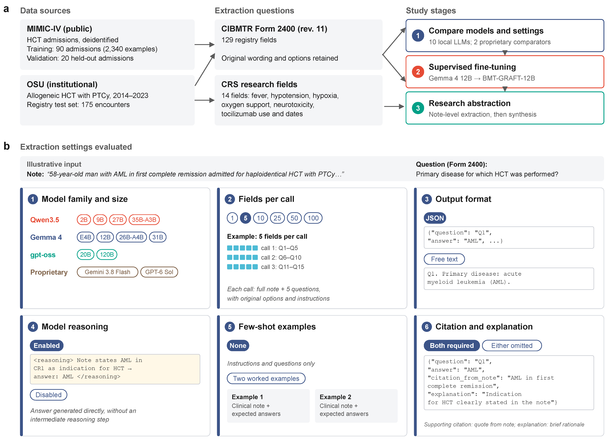

# BMT-GRAFT-12B

Code for **BMT-GRAFT-12B enables accurate and locally deployable clinical data extraction for hematopoietic cell transplantation**. GRAFT stands for Generative Registry Abstraction through Fine-Tuning. The model adapts Gemma 4 12B for CIBMTR Form 2400 extraction and is also evaluated on longitudinal transplant research questions.

- **Model:** [JWang580/BMT-GRAFT-12B on Hugging Face](https://huggingface.co/JWang580/BMT-GRAFT-12B).
- **Training dataset:** PhysioNet release forthcoming.
- **Documentation:** [Run the model](docs/running_the_model.md) · [Reproduce training](fine_tuning/README.md) · [Data availability](DATA_AVAILABILITY.md).

## Study overview



Figure 1 summarizes the study design and extraction settings evaluated. [Download the figure as a PDF](data_analysis/figs/fig1_study_design.pdf).

## Run the model

Run the released model on your own notes without downloading the training dataset. Start with the synthetic example:

```bash
python -m pip install -r prompt_eval/requirements-local.txt
python prompt_eval/run_finetuned.py --demo --dry_run
python prompt_eval/run_finetuned.py --demo --output prompt_eval/results/demo_predictions.json
```

The first inference run downloads the checkpoint and any required base weights. Hugging Face login may be required for model access. A compatible GPU is recommended; the dry run checks inputs without loading weights.

Extract all 129 registry fields from a UTF-8 note:

```bash
python prompt_eval/run_finetuned.py --note_file data/my_note.txt --date 2026-10-29 --all_fields --output prompt_eval/results/my_note_predictions.json
```

Outputs include answers, supporting quotations, explanations, and extraction statuses. Keep full outputs private. The [running guide](docs/running_the_model.md) covers installation, batch CSV inputs, quantization, offline use, and troubleshooting.

## Data access

Clinical notes, training conversations, evidence quotations, raw model responses, and note caches are excluded from the public repository. Obtain clinical inputs through the access procedures described in [data availability](DATA_AVAILABILITY.md).

Reviewed extracted answers and aggregate results may be shared. Use the [answer-only exporter](docs/publication.md#export-answers) to remove narrative fields and replace record identifiers before reviewing a table for release.

## Organization

| Directory or file | Purpose |
| --- | --- |
| `dataset_creation/` | Transplant screening, MIMIC record reconstruction, and reference-annotation preparation |
| `resources/` | Public Form 2400 question metadata, without patient records |
| `prompt_eval/` | Shared prompts, local/API inference, response validation, and registry scoring |
| `fine_tuning/` | LoRA supervised training; separate experimental RLVR workflow |
| `research_eval/` | Fourteen research targets, encounter linkage, note extraction, and scoring |
| `data_analysis/` | [Manuscript figures and R analysis scripts](data_analysis/README.md) |
| `scripts/` | Source-release checks, packaging, and answer-only export |
| `tests/` | Offline tests using synthetic records |

## Installation and tests

The analyses used Python 3.12. Run these commands from the repository root:

```bash
python -m pip install -r requirements.txt
python -m unittest discover -s tests -v
python -m unittest research_eval.test_research -v
python scripts/publication.py check
```

Tests use synthetic records and run on Python 3.11 or 3.12 without clinical data, a GPU, or API credentials. Install additional dependencies for the workflow you need:

- Local inference: `prompt_eval/requirements-local.txt`.
- Hosted comparators: `prompt_eval/requirements-api.txt`.
- SFT: `fine_tuning/requirements.txt`; recorded training versions are listed in [the reproducibility guide](docs/reproducibility.md).
- Experimental RLVR: `fine_tuning/requirements-rlvr.txt` in a separate environment.

Check GPU compatibility in the target environment. Hosted annotation and comparator scripts send supplied notes to the configured provider and require authorization for that use. Local inference does not require provider API credentials.

## Reproduce the workflows

1. Obtain the inputs and reserved MIMIC admission list described in [the data dictionary](docs/data_dictionary.md).
2. Construct the MIMIC-derived notes using [dataset creation](dataset_creation/README.md).
3. Follow [registry evaluation](prompt_eval/README.md) for request sizes, modes, full-note/chunked strategies, and scoring.
4. Follow [supervised training](fine_tuning/README.md) for the 90-record, 2,340-conversation training set and the 20 reserved admissions.
5. Follow [research evaluation](research_eval/README.md) for the separate 14-target longitudinal workflow.
6. Record exact inputs, model revision, software, hardware, generation configuration, and scoring policy using [the reproducibility guide](docs/reproducibility.md).

## Evaluation

Registry evaluation counts missing and failed responses as incorrect. The [scoring documentation](docs/scoring.md) explains the current response validation and the legacy policy used for comparison with archived outputs.

The [research workflow](research_eval/README.md) documents encounter-level synthesis, reference-label review, and scoring. Use the recorded label version and synthesis procedure when reproducing a result. RLVR is a separate experiment; BMT-GRAFT-12B was developed through supervised fine-tuning.

## Citation and licensing

Citation metadata is provided in [CITATION.cff](CITATION.cff). A software license has not yet been specified. Model use is governed by the Hugging Face release and upstream model terms; dataset use is governed by the source-data agreement and PhysioNet release terms. See [registry metadata](resources/README.md) for attribution of the CIBMTR form content.
